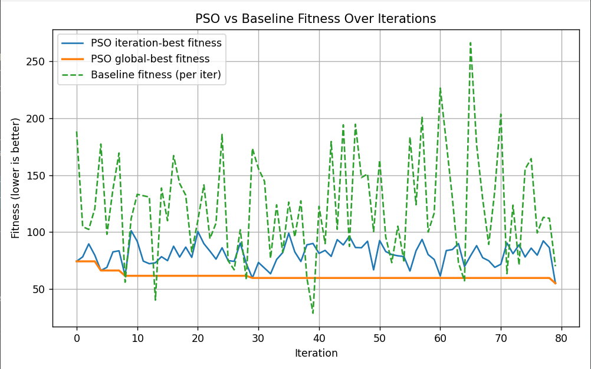
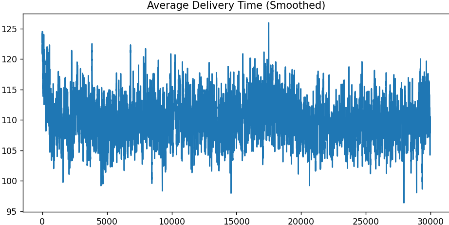
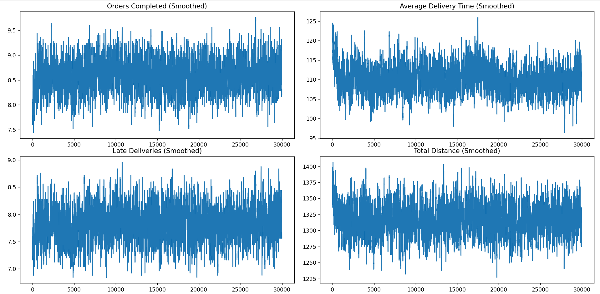

# Dynamic Food-Delivery Routing: PSO vs Reinforcement Learning

Year 3 AI coursework exploring the **Dynamic Vehicle Routing Problem (DVRP)** in a food-delivery setting. Orders appear in real time at households, must be collected from restaurants and delivered by a small fleet of capacity-limited vehicles. Two optimisation approaches are compared against simple heuristic baselines:

- **Particle Swarm Optimisation (PSO)**: tunes the weights of a dispatch-scoring heuristic.
- **Tabular Q-learning (RL)**: learns order-assignment and routing decisions directly.

## Simulation

All experiments use a discrete-time simulator on a grid world:

| Parameter | Value (paper runs) |
|---|---|
| Vehicles | 5 |
| Vehicle capacity | 2 simultaneous orders |
| Episode length | 300 s |
| Orders per episode | ~22 (dynamic arrivals) |
| Late deadline | 60 s |
| Distance metric | Manhattan |

Restaurant and household locations are fixed. Performance is measured by **average delivery time (ADT)**, **orders completed**, **lateness penalty** and **total distance travelled**, averaged over 30 evaluation runs.

## Approaches

### PSO (`Lib/PSO.py`)
Each vehicle scores candidate orders with a weighted sum of normalised features (travel time, order wait time, queue length, lateness risk). PSO (30 particles, 80 iterations, inertia decaying 0.9 → 0.4) searches for the weight vector that minimises a combined fitness:

```
fitness = W_ADT * ADT + W_DIST * distance + W_LATE * lateness
```

The best weights are compared against a distance-only baseline heuristic.

### Reinforcement learning (`Lib/rl.py`)
Two cooperating tabular Q-learning agents trained over 30,000 episodes with ε-greedy exploration:

- **AssignmentAgent**: per-vehicle Q-tables deciding whether to accept an order, using discretised distance, load, idle state and pending-order count.
- **RoutingAgent**: chooses the next stop (nearest pickup, nearest drop-off, overall nearest, or FIFO) based on task count, distance and wait time.

Rewards penalise distance travelled and late deliveries. The trained policy is evaluated greedily against a non-learning baseline.

## Repository structure

| File | Description |
|---|---|
| `Lib/PSO.py` | PSO implementation **used in the paper** |
| `Lib/rl.py` | RL implementation **used in the paper** |
| `Lib/rl_new.py` | Alternative single unified RL agent (experimental) |
| `Lib/algo_new.py` | Early simulator with nearest/random dispatch baselines |
| `Lib/mayIAI.py` | Real-road prototype using OpenRouteService travel times + Folium map output |
| `Lib/vrp_testing.py` | OpenRouteService / Folium routing test |
| `Lib/*.html` | Generated Folium maps |
| `overleafimages/` | Figures used in the report |

## Results

**PSO**



**Reinforcement learning**





## Running

Requires Python 3.10+.

```bash
pip install -r requirements.txt

python Lib/PSO.py      # PSO optimisation + evaluation vs baseline
python Lib/rl.py       # RL training (30k episodes) + evaluation vs baseline
```

The map-based scripts (`mayIAI.py`, `vrp_testing.py`) need a free [OpenRouteService](https://openrouteservice.org/) API key:

```bash
export ORS_API_KEY=your_key_here        # PowerShell: $env:ORS_API_KEY="your_key_here"
python Lib/mayIAI.py
```

Random seeds are fixed so results are reproducible.
